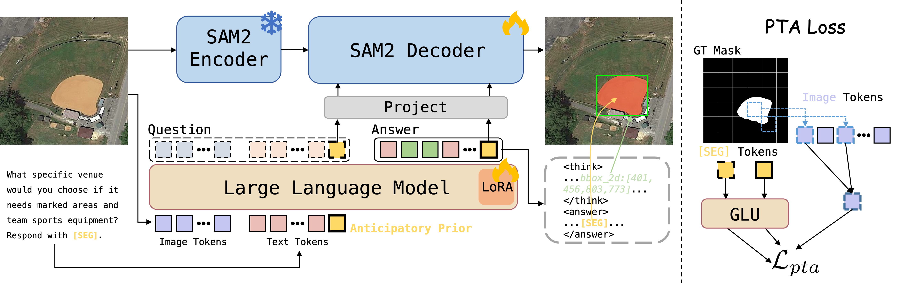

<h1 align="center">GeoReason</h1>
<h3 align="center">Bridging Logical Reasoning and Spatial Fidelity<br>in Remote Sensing Segmentation</h3>

<p align="center">
  Cheng Fan<sup>1</sup> · Han Wu<sup>2</sup> · Tingzhang Luo<sup>1</sup> · Minjing Dong<sup>1</sup> · Yehui Tang<sup>3</sup> · Jianyuan Guo<sup>1,*</sup>
</p>
<p align="center">
  <sup>1</sup>City University of Hong Kong<br>
  <sup>2</sup>School of Computer Science, Peking University<br>
  <sup>3</sup>Samsung<br>
  <sup>*</sup>Corresponding author: <a href="mailto:jianyguo@cityu.edu.hk">jianyguo@cityu.edu.hk</a>
</p>
<p align="center">
  <a href="https://neurips.cc/virtual/2026/poster/152062"></a>
  <a href="https://github.com/Fanc0126/GeoReason"></a>
  <a href="LICENSE"></a>
</p>

## 🔥 Overview

We introduce **GeoReason**, a framework that bridges logical reasoning and spatial fidelity for remote sensing segmentation.

<p align="center"></p>

## 🗞️ News

- **2026-10-17**: 💻 We release the training and evaluation code for GeoReason.
- **2026-09-24**: 🎉 GeoReason has been accepted to **NeurIPS 2026**!

## 📊 Results

### EarthReason

| Method | Val gIoU | Val cIoU | Test gIoU | Test cIoU |
|:--|--:|--:|--:|--:|
| LISA | 61.04 | 57.39 | 60.88 | 59.10 |
| PixelLM | 57.94 | 57.79 | 60.01 | 59.22 |
| PSALM | 66.61 | 62.03 | 68.30 | 64.61 |
| SegEarth-R1 | 68.60 | 64.13 | 70.75 | 68.25 |
| RemoteReasoner | 69.00 | 67.80 | 71.00 | 69.10 |
| Text4Seg++ | 71.90 | 69.80 | 73.00 | 65.60 |
| SegEarth-R2 | 72.30 | 68.10 | <ins>73.50</ins> | 69.50 |
| UniGeoSeg | <ins>72.54</ins> | <ins>73.30</ins> | 73.08 | <ins>74.61</ins> |
| GeoReason | **77.61** | **77.63** | **78.61** | **80.60** |

### RRSIS-D

| Method | Val gIoU | Val cIoU | Test gIoU | Test cIoU |
|:--|--:|--:|--:|--:|
| LGCE | 60.16 | 76.68 | 59.37 | 76.34 |
| RIS-DMMI | 60.72 | 77.01 | 60.12 | 76.20 |
| LAVT | 61.46 | 77.59 | 61.04 | 77.19 |
| RMSIN | 65.10 | 78.27 | 64.20 | 77.79 |
| LISA | 27.84 | - | 26.78 | - |
| PixelLM | 33.89 | - | 31.65 | - |
| NEXT-Chat | 26.98 | - | 24.98 | - |
| GeoGround | 61.10 | - | 60.50 | - |
| Text4Seg++ | 64.10 | 75.80 | 62.80 | 74.20 |
| SegEarth-R1 | 67.56 | 78.92 | 66.40 | 78.01 |
| GeoPixel | <ins>67.99</ins> | **81.77** | <ins>67.30</ins> | **84.90** |
| GeoReason | **68.36** | <ins>79.87</ins> | **67.32** | <ins>79.39</ins> |

## 🛠️ Installation

### Environment Setup

```bash
git clone https://github.com/Fanc0126/GeoReason.git
cd GeoReason
conda create -n georeason python=3.11 -y
conda activate georeason
pip install -e .
pip install flash-attn==2.8.3 --no-build-isolation
```

We use [Sa2VA-Qwen3-VL-4B](https://huggingface.co/ByteDance/Sa2VA-Qwen3-VL-4B) for our experiments.

### Data Preparation

Download and extract the datasets from their release pages:

| Dataset | Source |
|:--|:--|
| EarthReason | [Hugging Face](https://huggingface.co/datasets/earth-insights/EarthReason) |
| RRSIS-D | [RMSIN](https://github.com/Lsan2401/RMSIN#datasets) |
| GeoChat | [Hugging Face](https://huggingface.co/datasets/MBZUAI/GeoChat_Instruct) |
| VRSBench | [Hugging Face](https://huggingface.co/datasets/xiang709/VRSBench) |

Arrange the files as follows. Place the PNG images from `Images_train.zip` and `Images_val.zip` together in `data/VRSBench/images/`.

```text
data/
├── EarthReason/
│   ├── train/{images,labels,QAs}/
│   ├── val/{images,labels,QAs}/
│   └── test/{images,labels,QAs}/
├── RRSIS-D/
│   ├── JPEGImages/
│   └── rrsisd/{instances.json,refs(unc).p}
├── GeoChat_Instruct/
│   ├── GeoChat_Instruct.json
│   └── images/
└── VRSBench/
    ├── VRSBench_train.json
    ├── VRSBench_EVAL_Cap.json
    ├── VRSBench_EVAL_vqa.json
    └── images/
```

Build the training and evaluation manifests:

```bash
python -m georeason.prepare --root data --output data/prepared
```

This creates the segmentation splits, constructs the auxiliary caption/VQA mixture, and excludes RRSIS-D validation/test images from the auxiliary data. Bounding boxes and PTA patch targets are computed automatically from training masks. Use `--geochat-images` and `--vrsbench-images` to specify alternative image folders relative to `--root`.

### Training

```bash
torchrun --standalone --nproc_per_node=4 -m georeason.train \
  --config configs/georeason.yaml --output outputs/georeason
```

The default configuration uses one epoch, a learning rate of `4e-5`, and an effective batch size of `64` (4 GPUs × 2 images × 8 accumulation steps). The final checkpoint is saved to `outputs/georeason/final.pt`.

#### Component Switches

| Switch | Component |
|:--|:--|
| `--ap` / `--no-ap` | Prompt-side `[SEG]` spatial anchor |
| `--bbox-cot` / `--no-bbox-cot` | Intermediate bounding-box reasoning |
| `--pta` / `--no-pta` | Latent patch-to-token alignment loss |

All three components are enabled by default. For example:

```bash
# Baseline
torchrun --standalone --nproc_per_node=4 -m georeason.train \
  --no-ap --no-bbox-cot --no-pta --output outputs/baseline

# AP + PTA
torchrun --standalone --nproc_per_node=4 -m georeason.train \
  --no-bbox-cot --output outputs/ap_pta
```

### Evaluation

```bash
torchrun --standalone --nproc_per_node=4 -m georeason.evaluate \
  --checkpoint outputs/georeason/final.pt \
  --dataset earthreason --split test --output outputs/earthreason_test

torchrun --standalone --nproc_per_node=4 -m georeason.evaluate \
  --checkpoint outputs/georeason/final.pt \
  --dataset rrsisd --split test --output outputs/rrsisd_test
```

Use `--split val` for validation, or `python -m georeason.evaluate` for single-GPU evaluation. Add `--save-masks` to save predicted binary masks.

## 📝 Citation

The arXiv release is in preparation. BibTeX will be added soon.

```bibtex
```

## 🙏 Acknowledgements

Built on [Sa2VA](https://github.com/bytedance/Sa2VA), [Qwen3-VL](https://github.com/QwenLM/Qwen3-VL), and [SAM2](https://github.com/facebookresearch/sam2). We thank the dataset authors for releasing EarthReason, RRSIS-D, GeoChat, and VRSBench.
